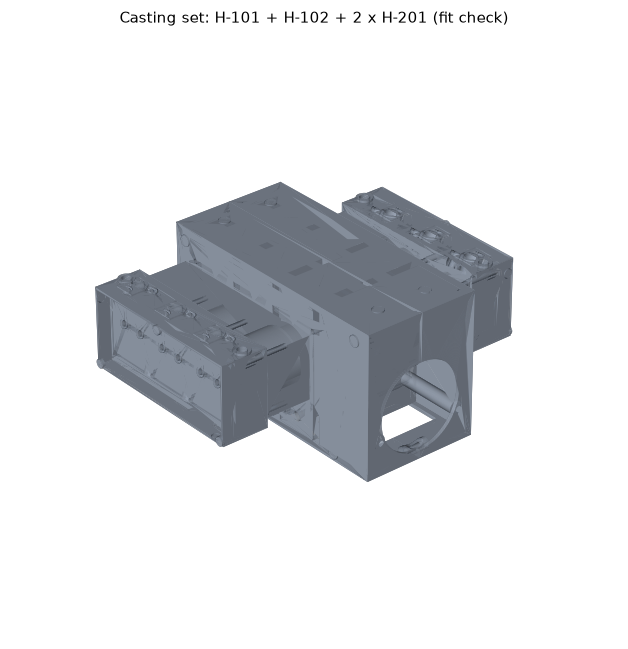
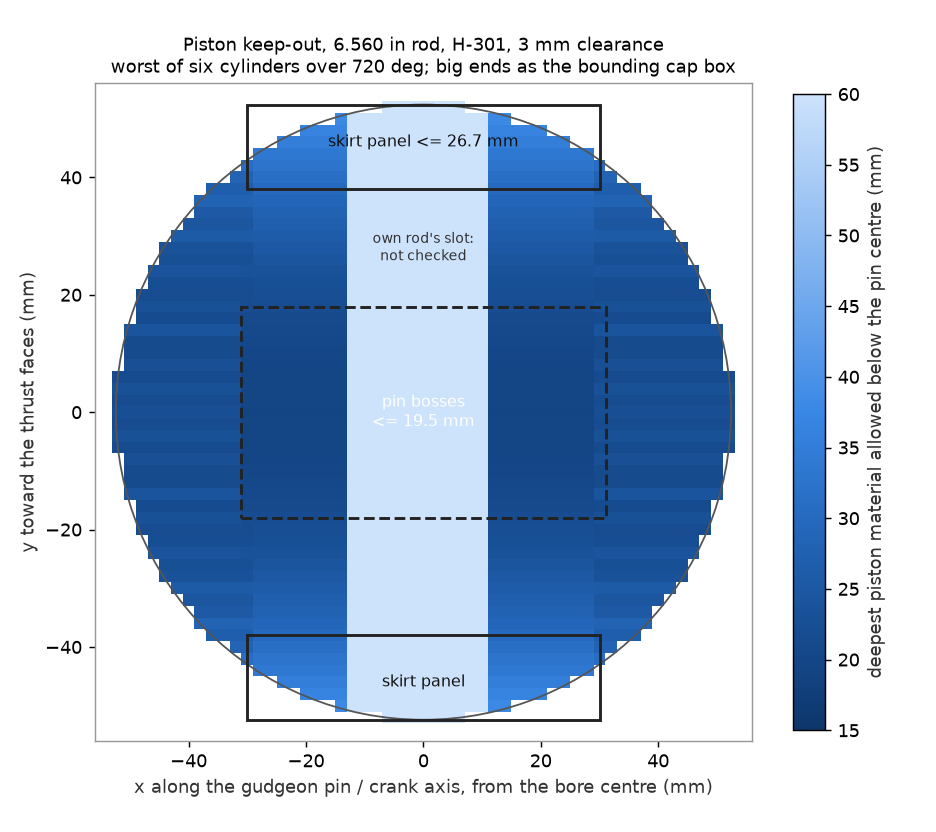

# Concept H castings: rulings on the DFM objections, the liner, the coarse STEP, and the cost floor on both bases

Owner: PROPULSION. Issue: AER-3331 (parent AER-3330; follows AER-3329 and MANUFACTURING envelope v1, AER-3328). Date: 2026-10-16.
**Revision A, 2026-10-18 (AER-3442): the castings now take crank H-301's 122.0 mm bank pitch and a 246.0 mm deck set by a longer rod. See section 9; sections 2-8 keep their AER-3331 numbers except where marked.**
Status: **design rulings and coarse geometry. Nothing here has been made, measured or run.** This is an experimental engine design. Nothing in it is certified, certifiable or flight-ready.

Numbers come from `analysis/engine_phase1/castings_h.py` (tables in `castings_h_tables.md`) and from the models in `cad/concept_h/` (`PART_LIST.md`). Cost lines are MANUFACTURING's bottom-up estimates [E] on sourced rates, as in RECOST_PHASE1B.md. None is a quote.

## 1. The answer

1. **Six castings become four, on three part numbers.** Each cylinder bank is cast into its crankcase half, and one head part number serves both banks. Five of MANUFACTURING's seven objections are accepted as written. Item 4 (the 4-axis head) is accepted with one constraint dropped. Item 3 is accepted for the heads and is moot for the blocks, because item 1 deletes the blocks.
2. **The Darton MID wet liner stays.** Against a dry sleeve in a closed deck it costs **2.9-4.1 kg per engine**, not the 15-18 kg of iron it weighs. The open deck is what makes the merged case castable and the liner a builder-replaceable part.
3. **The coarse STEP of each surviving casting is drawn and committed** (`cad/concept_h/`, PROPULSION drew it). Datums, critical bores and alloys are shown. The three parts assemble with zero overlap. *Rev A:* redrawn at H-301's pitch and the new deck, and H-301 turns inside the case halves with zero overlap (section 9).
4. **The 200 hp cost floor, after the rulings, on both bases:**

| Basis | Low / mid / high | Against $22k |
|---|---|---|
| **1. First engine carries all program NRE** | **$31.7k / $48.0k / $72.8k** | $9.7k over at the low end |
| **2. Each engine of a batch of 5, NRE paid once by the program** | **$25.1k / $35.2k / $49.3k**, plus **$5.1k-19.2k of NRE once** | $3.1k over at the low end |

Against MANUFACTURING's six-casting line items, the rulings take **$3.8k-13.2k off the first engine and $1.2k-3.9k off each engine of five**. Removing a double count in the machine-shop line takes another $0.3k-1.3k (section 6). Neither basis meets $22k. Which basis R-35 means is Bill's question on AER-3330, so this document does not pick one.

## 2. Rulings on envelope v1 section 9.5

| # | Objection | Ruling | The reason, in numbers |
|---|---|---|---|
| 1 | Merge each cylinder-bank block into its crankcase half | **Accept** | Deletes 2 castings, 2 base gaskets and about 24 studs and nuts. First-op plus castings fall by **$1.7k-5.3k on the first engine** and **$1.1k-3.0k per engine of five**. The scrap risk it adds is worth **$0.1k-0.2k per engine** in expectation, at an assumed 5-20 % scrap rate per bureau pour, if every casting is radiographed before first-op. The liner registers come off the same setup as the mains, so bore-to-crank squareness no longer stacks through a bolted joint. |
| 2 | Crankcase in one HMC setup on the doweled pair | **Accept** | Every feature after the split face lies on an axis parallel to the crank (mains, cam, gallery) or to the cylinders (lifters, decks, registers, head studs, main studs). The pair sits on its pan-rail face and indexes 0/90/180/270. From the STEP the pair is **563 x 331 x 470 mm** across both decks and about 42 kg (model mass, an upper bound). **Machine: an HMC with a 630 mm pallet or larger and about 1,000 mm swing** (833 mm needed for the part plus clearance), Y travel of about 500 mm with a riser, and a damped boring bar for the mains, bored 280 mm from each end through 64 mm housings (L/D about 5-6). The align hone stays at the automotive shop. MANUFACTURING's 325 mm-per-half box was conservative; the deck sits 235 mm from the split plane. |
| 3 | Left = right bank blocks; can the heads be one part number? | **Blocks: moot (deleted by #1). Heads: accept, one part number.** | The RH bank takes the head rotated 180 degrees about the vertical axis. That rotation keeps top as top, so intake-up and exhaust-down survive it. It works if the head-stud pattern and ring dowels are symmetric, there is a coolant boss at each end (one plugged per bank), and the cam's lobes follow the reversed valve order on one bank (the cam is custom anyway). Taking this ruling on its own (#1 + #3 against #1 alone) cuts **$1.7k-6.3k of NRE once and $1.9k-7.0k off the first engine**. **The case halves cannot be one part number**: the nose carries the thrust faces, the rear carries the cam drive, the cam sits in the split plane below the crank, and the banks are offset 38.6 mm along the crank. |
| 4 | Head as a 4-axis part | **Accept the aim. Drop "both port flanges on one face."** | The rule that does the work is **every machined axis normal to the head's long axis**. A rotary along the row then reaches every feature. The valve axes are parallel at 15 degrees. Plug set A comes from the top face and plug set B from the bottom, and each set is parallel. Injectors, ports and rocker pads follow the same rule. Ports on opposite faces (intake top, exhaust bottom, as on Continental's flat engines) are reachable on 4-axis. Putting both on one face would only add charge heating on an engine that is already knock-limited (CR about 8.4 on 91 AKI, RANKING_PHASE1.md section 3). **Drawing the head found one more feature to move**: coolant bosses on the end faces point along the row, where 4-axis cannot reach. They are now on the top face at both ends. Saving: per-head marginal first-op falls from $0.3k-1.0k to $0.2k-0.6k at a batch of 10. That is less than MANUFACTURING's $300-900, because I added 0.5 h of indexing time to the cycle. |
| 5 | Liner registers stepped from one side | **Accept: drawing rule DR-2** | Drawn as lower register 116 mm, jacket 127 mm, flange seat 131.4 mm, all bored from the deck in setup B. The exact diameters come from Darton's MID preparation drawing [Q]. |
| 6 | Drilled galleries within 25 x D; 12 mm main gallery or a gun-drill | **Accept, at 14 mm, with one rule added** | 27 kW of heat to oil at 200 hp needs about 60 L/min at a 15 K oil rise. Through 12 mm that is 8.9 m/s and up to 0.49 bar of drop along 560 mm. Through 14 mm it is 6.5 m/s and 0.24 bar, at 20 x D from each end (a full-flow upper bound; the flow falls along the gallery). **Added because of #1:** at least 5 mm of metal between any drilled oil passage and a coolant jacket. Threaded plugs with sealant, staked; no cup plugs on a pressurized passage. |
| 7 | Cleanout exits for printed-sand cores | **Accept, threaded plugs only** | Each head jacket core has two 22 mm exits: the coolant bosses at both ends. One is the coolant outlet; the other gets one threaded plug. The case jacket is open to the deck, so it needs no exits. **No Welch or cup plugs on any coolant jacket.** A plug lost in flight is a coolant loss, about 1 minute at MCP (FL-27). That is not worth the few dollars a press-in plug saves. |

### What the merge gives up

- **A scrapped pour scraps the whole half.** That is priced above. Radiographing every casting before first-op (DR-8) makes it a casting cost, not a casting-plus-machining cost.
- **Coolant now runs in the crankcase half.** A porosity path or crack between the jacket and the crank bay, or a drilled oil passage, puts coolant in the oil (FL-38). DR-6's 5 mm wall, radiography and a jacket pressure test before the liners go in are the mitigation.
- **The precedent is weaker than 9.5 states.** Subaru's EJ and EZ flat engines do cast the banks into the case halves. But they run cast-in iron liners in an open deck, not wet liners [E, general practice]. The integral case is proven. The wet liner in an integral flat case is ours to prove.

## 3. The liner: Darton MID wet liner, kept (envelope 9.4)

| | Darton MID wet liner, open deck | Dry iron sleeve, closed deck |
|---|---|---|
| Mass per cylinder | 2.76-2.96 kg of iron (0.220 in wall, 180 mm long [ASSUMED], flange) | 1.15 kg of iron (3 mm) **plus 1.12 kg of A356** (the 6 mm cylinder wall and closed deck the sleeve needs) = 2.27 kg |
| **Per engine** | **+2.9 to +4.1 kg against the dry sleeve** | baseline |
| Hoop stress at 70 bar peak pressure [ASSUMED] | 66 MPa, with no aluminum behind it | carried by the aluminum wall |
| Casting | jacket is a pocket open to the deck: the core is held and cleaned out through the deck | jacket is a closed core inside the largest casting: residual-sand risk next to the bore (FL-34), and a core shift thins the wall that must hold the sleeve's interference |
| Running surface | bored 0.020 in and honed after install (the liner line includes it) | bored and honed after the press fit |
| Overhaul | builder replaces the liner (B1) | shop presses out, re-bores the aluminum, presses in, bores and hones |
| Failure path it adds | bottom O-ring seal: coolant into the oil (FL-35) | none of its own; a loose sleeve is a shop defect |

**Ruling: keep the wet liner, and take the Darton MID for the first articles.** It is a catalog part that fits the LS bore pitch and the LS7 piston, it is what makes the merged case an open-faced casting, and it keeps the liner a builder part.

**Correction to RECOST_PHASE1B.md section 7.** Phase 1b credited a thin dry sleeve with saving 6-7 kg. That counted the iron and left out the aluminum cylinder wall and closed deck that a dry sleeve needs. On the like-for-like comparison above, the saving is **2.9-4.1 kg**. Phase 1b's 9.4-11.2 kg MID penalty stands as the mass the MID adds over phase 1's allowance. Only the size of the lever against it changes.

**The lever kept for later:** a custom wet liner with a 3.5 mm wall weighs about 1.8 kg, against 2.8 kg, at a hoop stress of 105 MPa. That is about 6 kg per engine for a custom part with no catalog source [Q]. It is not worth it for first articles.

## 4. The coarse STEP (envelope 9.6)

**Owner of record: PROPULSION drew it.** I did not take MANUFACTURING's offer to draft it, because drawing it was the test of rulings 2-4. Two findings came only from the geometry: the head's end-face coolant bosses broke the 4-axis rule, and MANUFACTURING's merged-case box was 90 mm deeper than the part.

| Part number | Casting | Qty / engine | Alloy | Model box (mm) | Model mass |
|---|---|---|---|---|---|
| H-101 | crankcase half LH, bank merged | 1 | A357-T6 | 563 x 331 x 235 (**Rev A: 593.6 x 331 x 246**) | 20.9 kg (**22.4**) |
| H-102 | crankcase half RH, bank merged | 1 | A357-T6 | 563 x 331 x 235 (**593.6 x 331 x 246**) | 21.0 kg (**22.5**) |
| H-201 | cylinder head, both banks | 2 | A356-T6 | 384 x 190 x 113 (**404.4 x 190 x 113**) | 7.1 kg (**7.5**) |

- **What is on the models:** datums A/B/C (split face and two reamed dowels on the case; deck and two ring dowels on the head), the as-cast 3-2-1 locating pads for the first setup, and every critical bore with its location: mains, cam, lifters, liner registers, head and main studs, main gallery, seat-insert and guide bores, both plug sets, injectors, ports and coolant bosses. The full list is `cad/concept_h/PART_LIST.md`.
- **What is not:** the case perimeter flange and its bolts, ribs, oil cross-drillings, fillets, draft, the real chamber and port shapes, and the coolant transfer passages, which wait on the MID flange drawing [Q].
- **Mass check.** The set is 56 kg of model metal (2 x 20.9 + 2 x 7.1). MANUFACTURING's six envelopes summed to 50-64 kg. The case halves are an upper bound (solid bulkheads, no lightening).
- **Checks run:** each STEP reads back as one valid solid. Case/case and head/deck overlaps are 0 mm^3.

Renders and regeneration commands: `cad/concept_h/README.md`.

## 5. Drawing rules (accepted rulings, plus the two the merge adds)

| ID | Rule | From |
|---|---|---|
| DR-1 | Every precision bore houses a bought part; the casting never carries a running surface. | envelope finding 2 |
| DR-2 | Liner registers stepped: flange seat >= jacket >= lower register, all bored from the deck in one setup. | 9.5 #5 |
| DR-3 | Case pair: every machined feature after the split face lies on an axis parallel to the crank or to the cylinders, so one HMC setup with 90-degree indexing reaches it. The pan-rail face is machined in setup A and locates setup B. | 9.5 #2 |
| DR-4 | Head: every machined axis is normal to the head's long axis; the valve axes are parallel. | 9.5 #4 |
| DR-5 | Head: symmetric under a 180-degree rotation about the vertical axis (stud pattern, ring dowels, a coolant boss at each end), so one part number serves both banks. | 9.5 #3 |
| DR-6 | Drilled runs no longer than 25 x D from their entry face; main gallery 14 mm; at least 5 mm of metal from any oil passage to a coolant jacket; threaded, sealed, staked plugs, no cup plugs on pressure. | 9.5 #6, plus the merge |
| DR-7 | Every printed core has at least two exits of 12 mm or more; exits close with threaded plugs, never Welch or cup plugs. | 9.5 #7 |
| DR-8 | Every structural casting is radiographed before first-op, and its jacket pressure-tested before liners are fitted. | the merge |
| DR-9 | Case halves A357-T6, heads A356-T6, degassed, T6 with a certificate, impregnated after machining. | envelope 1.2, RANKING_PHASE1.md section 10 |

## 6. The 200 hp cost floor, rerun on both bases

`castings_h.py`. Low / mid / high; mid is the geometric mean of the band, as in phases 1 and 1b. Step 1 reproduces `cost_v1.py` (AER-3329) exactly on both bases.

| Step | Basis 1: first engine, carries all NRE | Basis 2: each engine of 5, NRE paid once |
|---|---|---|
| 0. Phase 1 as published | $23.2k / $36.8k / $58.4k | $23.2k / $36.8k / $58.4k |
| 1. Envelope 9.7 line items, six castings (= RECOST_PHASE1B "H as sent") | $35.8k / $55.9k / $87.3k | $26.7k / $38.1k / $54.5k |
| 2. + rulings 1-4: four castings, three part numbers, 4-axis head, STEP boxes | $32.0k / $48.7k / $74.1k | $25.5k / $35.9k / $50.6k |
| **3. + the machine-shop double count removed** | **$31.7k / $48.0k / $72.8k** | **$25.1k / $35.2k / $49.3k** |

- **Program NRE on basis 2:** $5.1k-19.2k once (CAM programs and fixtures for three part numbers), down from $7.2k-26.7k for six castings. Spread over five engines instead of carried by the program, basis 2 becomes $26.1k-53.2k per engine.
- **The machine-shop double count (step 3)** is a correction, not a ruling. Phase 0's `MACHINE_SHOP` line ($0.8k-2.0k x 1.3) was built from the align hone, two decks, six bores and hones, valve work and balancing. Since then the bore and hone moved into the liner line (9.4), the balance into the crank line (9.4), the valve work was already carried in the seats-and-guides line, and the decks moved into first-op (9.7). Only the align hone is left: $350-570. Phase 1b's figures carry the same double count, of about $0.3k-1.3k.
- **Against phase 1b's DFM variant** ($25.8k / $34.5k at the low end, items 1 and 4 only): the one-part-number head and the STEP boxes take another $0.3k (basis 2) to $2.5k (basis 1) off the low end. The NRE falls by $2.1k-7.9k, because phase 1b kept two head programs.
- **What still dominates:** on basis 1, first-op ($7.2k-24.4k), because one engine pays for every CAM program and fixture. On basis 2, the crank ($6.6k-9.4k), then castings ($4.1k-8.4k) and the catalog per-cylinder set ($2.7k-4.5k). Full line items: `castings_h_tables.md`.

**F-5 is still a miss on both bases.** This pass does not change the card on AER-3329 or Bill's basis question on AER-3330. It moves the numbers both are about.

## 7. Failure ledger

Added to `FAILURE_LEDGER.md`: **FL-38**, coolant into the oil through the merged case half, and **FL-39**, loss of a head jacket plug. FL-34 is reworded, because there is no longer a separate block jacket.

## 8. What this pass did not do

- **No quotes.** Every cost line is still [E]. The STEP files are what an RFQ needs (envelope 9.6). Who sends it is the AER-3330 question.
- **No Darton MID preparation drawing.** Register diameters, the flange seat and the coolant transfer passages are placeholders until Darton's drawing is in hand [Q]. The MID sleeve length is also unpublished. The 180 mm length, and the skirt's clearance to the crank counterweights, are open until the crank is drawn.
- **No crank drawing.** The 38.6 mm bank offset and the 14.6 mm webs come from a catalog-class rod (LS, 0.940 in big end) and 20 mm main bearings [E]. The crank drawing could move the cylinder positions by a few millimetres. *Closed by Rev A: H-301 is drawn (AER-3439) and the castings follow it (section 9).*
- **No FEA.** The merged case's bulkheads and bank are drawn to casting-rule walls, not to stress. The first structural check is the main bulkhead under firing load plus propeller gyroscopic moment, on the doweled pair.
- **Scrap rate** is assumed (5-20 % per pour). No bureau publishes a one-off rate.
- **The mass credit for the merge** (the two flange pairs and studs it deletes, about 2-3 kg [E]) is not taken in H's 148-158 kg. It is smaller than the band.

## 9. Revision A: H-301's pitch, and a deck set by the rod and piston (AER-3442)

Crank H-301 Rev A (`CRANK_H301.md`, AER-3439) moved the main spacing from 111.8 to 122.0 mm for web margin. Its clearance sweep also found that the LS7 stack (6.067 in rod, 235 mm deck, Darton 147.3 mm sleeve) does not clear the staggered opposed crank at BDC. This revision picks the rod, piston, liner and deck, and redraws H-101, H-102 and H-201 to match. Numbers come from [`analysis/engine_crank/stack_h.py`](../../analysis/engine_crank/stack_h.py) (tables in `stack_h_tables.md`), sources from [`sources/STACK_SOURCES_2026-10-18.md`](sources/STACK_SOURCES_2026-10-18.md).

### 9.1 The answer

1. **Rod: Callies Compstar CSC6560DS2A2AH, 6.560 in, on the 2.100 in journal** [S, Callies 2022 catalog p. 18; 0.927 in pin read from the part-number code, E]. **Piston: MAHLE 930221625, 4.125 in, CH 1.105 in, 438 g** [S], with its skirt panels relieved to 26 mm below the pin where the crank passes. **Deck 246.0 mm** from the crank axis (+11.0 mm per side). **Liner: Darton MID cut to 146.0 mm** (1.3 mm off the bottom), so its bottom sits 100 mm from the axis.
2. **On that stack, `crank_decision.py` section 6 gives a smallest gap of 4.5 mm** (middle web to the pin boss), with the big ends modelled as a bounding cap box. The rest are 5.0 mm or more. The liner bottom clears by 5.9 mm or more.
3. **The castings and H-301 now share one pitch and one deck by construction.** `h_castings.py` reads the pitch, the main positions and the pin offsets (40.35 / 81.75 mm from each bay's front main) from `h301_params.json`, the file H-301's STEP is built from. It reads the deck and liner from `h_stack.json`, which `stack_h.py` writes. H-301 turned through 360 degrees inside H-101 and H-102 overlaps them by 0 mm^3 at every 15 degrees. The same check finds up to 189,000 mm^3 against the AER-3331 castings.
4. **What is not proven: no catalog drawing of the rod's big end or the piston's skirt exists in public.** Every vendor publishes only fit dimensions (section 9.2). So the 3 mm is shown against a keep-out spec and a bounding outline, not against a vendor drawing. The issue's done-when asks for vendor drawings, and **that part stays open** (section 9.6).

### 9.2 What the catalogs give, and what they do not

Vendors publish rod length, journal, pin, big-end width (0.940 in) and cap-screw size (7/16 in), and the piston's compression height, pin size and pin length (2.250 in). **No vendor found publishes a big-end outline, a cap-screw spacing, a skirt length or a boss depth** (Callies, K1, Manley, Molnar, MAHLE, JE, Wiseco, Diamond, CP; read 2026-10-18). So the check was turned round. `stack_h.py` sweeps H-301 through 720 degrees and maps, in each piston's own frame, how high the crank reaches toward the gudgeon pin. That map is a **keep-out spec**. A piston whose material stays out of it, by drawing or by measurement, clears by 3 mm.

*Deepest piston material allowed below the gudgeon-pin centre for 3 mm, worst of six cylinders over 720 degrees, big ends as the bounding cap box. Darker means the crank comes closer. Dashed: the pin-boss zone. Solid: the skirt panels. The light centre strip is the piston's own rod slot, which is not checked against its own rod.*

The big end is run three ways, because its outline is the main unknown: a 42 mm circle about the pin [E], a 46 mm circle [A], and a **bounding cap box** of 81.8 x 68 mm [E]. The box is the 2.225 in housing bore [S, K1], a 5.7 mm cap wall, and 7/16 in 12-point cap-screw heads at the corners, 53 mm from the pin.

### 9.3 Why the rod has to be long: the middle web, not the big end

| Rod (in) | Deck (mm) | Pin-boss depth allowed for 3 mm (mm) | Over an 18 mm boss [E] | Set by |
|---|---|---|---|---|
| 6.067 (LS7) | 233.5 | 7.0 | -11.0 | middle web |
| 6.350 | 240.7 | 14.2 | -3.8 | middle web |
| 6.460 | 243.5 | 17.0 | -1.0 | middle web |
| **6.560** | **246.0** | **19.5** | **+1.5** | middle web |

The decks in this table use the CH 1.105 in piston. At BDC the opposed pin in the same bay points at this piston, and **H-301's middle web, 42.5 mm in radius about that pin, comes within 93.3 mm of the axis**. A real 0.927 in pin boss reaches about 17-18 mm below the pin centre [E: an 11.8 mm pin radius plus a boss wall]. So the rod must put the BDC pin at least about 114 mm from the axis. Neither the big-end model nor skirt relief changes this, because a boss cannot be relieved. **6.560 in is the shortest catalog rod with margin over an 18 mm boss.** 6.460 in (Callies U16301) would need a boss no deeper than 17.0 mm, and no published number says one is. The other way to buy those millimetres is a narrower middle web on H-301 (each 1 mm off its end radius is 1 mm of clearance). That is a Rev B crank change, so it is not taken here.

### 9.4 The stack

| Item | Pick | Basis |
|---|---|---|
| Rod | Callies Compstar CSC6560DS2A2AH, 6.560 in (166.6 mm), 2.100 in journal, 0.927 in pin, 655 g, rated 1,000 hp | [S]; pin [E, from the code]; one rod per pin, 0.940 in big end as H-301 is drawn |
| Piston | MAHLE 930221625, 4.125 in, CH 1.105 in (28.1 mm), 0.927 in pin, 4032, 438 g | [S]. The CH sets the deck and is not what clears the crank: the BDC pin height is rod minus half-stroke whatever the CH |
| Piston relief | pin bosses no deeper than **19.5 mm** below the pin centre; skirt panels no deeper than **26.7 mm** where the crank passes (|x| <= 30, |y| >= 38 mm); nothing below the ring belt elsewhere | keep-out map; [Q] against MAHLE's drawing. If the catalog panels run 30 mm, that is up to 3.3 mm off the panel bottom, a lathe or mill cut of the kind Continental makes on its pistons ("cylindrical relief cuts ... to clear the crankshaft counterweights" [S, IO-520 manual]) |
| Deck | **246.0 mm** from the crank axis = 50.8 + 166.6 + 28.1 + 0.5 mm crown below the deck | stack_h.py; compression ratio unchanged, because the crown-to-deck gap is held |
| Liner | Darton MID, **146.0 mm** long (147.3 cut 1.3 mm at the bottom), bottom 100 mm from the axis | the crank needs 97.1 mm or more; the oil ring stays covered at BDC with the bottom up to 124.3 mm. 14.2 mm of a 30 mm skirt leaves the liner at BDC, against 14.4 mm for an LS7 in its own block |
| Bank pitch and pins | 122.0 mm; LH pins 40.35 mm and RH pins 81.75 mm behind each bay's front main (bank offset 41.4 mm) | read from h301_params.json |

**Knock-on checks.** The rod-and-piston mass matches what the torsion and balance work assumed: about 0.84 kg reciprocating and 0.44 kg rotating per cylinder [E, a third / two thirds split of the rod], against crank_decision.py's 0.90 and 0.45 [A]. So H-301's torsion case (section 4 of CRANK_H301) stands. The rod ratio rises from 3.0 to 3.28, which lowers the side thrust.

### 9.5 The castings at Rev A

| | AER-3331 | Rev A | Change |
|---|---|---|---|
| Main housings, x (mm) | 60.0 / 171.8 / 283.6 / 395.4 | **60.0 / 182.0 / 304.0 / 426.0** | H-301 |
| Bores LH / RH, x (mm) | 96.6 / 208.4 / 320.2 and 135.2 / 247.0 / 358.8 | **100.3 / 222.3 / 344.4 and 141.8 / 263.8 / 385.8** | H-301's pins |
| Deck from split plane | 235 | **246** | +11 per side |
| Case half box (mm), model mass | 563 x 331 x 235, 20.9-21.0 kg | **593.6 x 331 x 246, 22.4-22.5 kg** | +1.5 kg each |
| Head box (mm), model mass | 384 x 190 x 113, 7.1 kg | **404.4 x 190 x 113, 7.5 kg** | +0.4 kg each |
| Set across both heads | 563 x 331 x 696 | **593.6 x 331 x 718** | +22 mm wide |
| Casting metal per engine (model, upper bound) | 56 kg | **59.9 kg** | still inside MANUFACTURING's 50-64 kg |
| Main gallery | 14 mm, 280 mm from each end (20 x D) | 14 mm, **295 mm from each end (21 x D)** | inside DR-6's 25 x D |
| HMC swing for the doweled pair (part diagonal + 100 mm) | 833 mm | **about 871 mm** | still inside about 1,000 mm (ruling 2) |

Drawn checks: each STEP reads back as one valid solid. Case/case and head/deck overlaps are 0 mm^3. H-301 turned through 360 degrees in the case overlaps it by 0 mm^3 at every 15 degrees (`cad/concept_h/crank_in_case.json`). That last check is static: it tests the crank against the case only, not the rods and pistons, which section 9.4 covers. The cam-lobe and lifter positions keep their AER-3331 layout about each bay's centre, about 6-14 mm from the valves along the row, as before. The rulings in section 2 and the drawing rules in section 5 are unchanged. **The cost floor in section 6 is not rerun.** About 7 % more casting metal and an 11 mm taller bank move the castings and first-op lines by less than their bands' width [E].

**Machining stock and rough pads (MANUFACTURING's correction, AER-3442).** The part list's 1.5-3 mm stock was a long-run, machine-moulded figure (ISO 8062 CT7-9). A one-off binder-jet sand casting holds about CT10-12, and stock per side is RMA + CT/2. That is 5.0 / 6.8 / 10 mm on the case split face and 4.8 / 6.5 / 9.5 mm on the head deck (CT10 / 11 / 12, MANUFACTURING's figures). Too little stock leaves cast skin on a sealing face, and the part is scrapped at first-op after everything else has been paid for. **Taken as proposed:** each part now carries `ISO 8062 - CT11 - RMA 4 (G)`, with about 7 mm planned on the split face and the deck. The RFQ asks the foundry which grade it holds, and its answer becomes the basis. `PART_LIST.md` now lists every rough datum pad with its centre, normal, size and one stated height (3 mm proud), so the 2-degree draft on the secondary and tertiary walls cannot shift the part at setup. The models are as-machined, so no geometry changed. The added sand, metal and cycle time are not costed; MANUFACTURING carries them into the next estimate.

**Found by drawing it, not fixed here:** the liner flange seats (131.4 mm) are wider than the 122 mm bore pitch, so neighbouring seats intersect by 9.4 mm (by 19.6 mm at 111.8). That was true in AER-3331 too. Whether Darton's MID flanges are flatted to sit at a 4.400 in pitch, and so at 122 mm, is on its preparation drawing [Q], with the register diameters already waiting on it.

### 9.6 What is open, and what would close it

- **The vendor drawings.** MAHLE's piston drawing for 930221625 (skirt panel depth and chord, boss depth) and Callies' drawing for the CSC6560 big end (cap-screw spacing, head clearance radius) close the done-when. Faster and cheaper: **buy one rod and one piston and measure them** (about $166 for a piston [S, Wiseco price class] plus one rod [Q]), then rerun `stack_h.py`. Either is an outbound request, so it waits on who sends RFQs (AER-3330/AER-3333).
- **The residual if the cap is unusual.** A big end that reaches 46 mm below the pin on its centreline (the 46 mm circle) leaves 1.0 mm to the piston. The bounding box puts the cap centre at 34 mm. A rod whose cap is deeper than that fails, and the drawing or a measurement decides it.
- **Darton's MID drawing** for the cut length (1.3 mm off the bottom must not reach the lower O-ring land) and the flange seat [Q].
- **An assembly check, before anything turns under power:** turn every engine over by hand with clay on the piston skirts and the liner bottoms, then measure the clay. On a stack this tight, a wrong part locks the engine on its first turn.
- **Recommend; Bill declares any freeze.** Nothing here has been made, measured or run.

