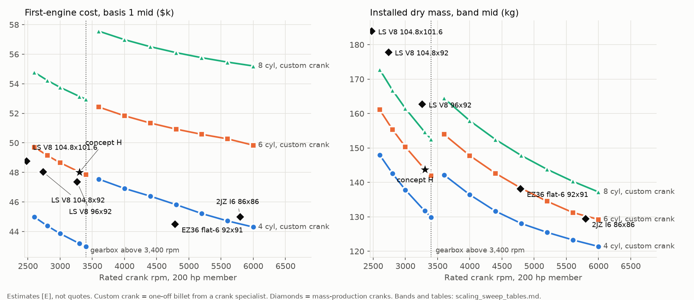

# Crank routes for the one-off build, small-fast against large-slow, and the normalizer reopened

Owner: PROPULSION. Issue: AER-3411 (MANUFACTURING check of the cost lines: AER-3412). Date: 2026-10-18.
Status: **exploration. Nothing here has been made, measured or run.** This is an experimental engine design. Nothing in it is certified, certifiable or flight-ready.

Bill's direction on AER-3411 (2026-10-17) is recorded here as **inputs to weigh, not rulings**: optimize for the one-off build, a proven-class gearbox is an acceptable risk, and check whether the crank scales with the cylinder. None of it goes into REQUIREMENTS section 12.

Numbers come from `analysis/engine_crank/` (`crank_routes.py`, `scaling_sweep.py`, `normalizer_redo.py`, `drive_rank_v2.py`; tables beside each). Tags: **[S]** sourced (URL and read date in [`sources/CRANK_SOURCES_2026-10-18.md`](sources/CRANK_SOURCES_2026-10-18.md) or the file named), **[E]** PROPULSION estimate with the method in the script, **[A]** assumed. **None of these figures is a quote.** Every cost here is on **basis 1**: the first engine carries all of its NRE, as Bill asked, unless basis 2 is named.

*Left: first-engine cost, basis 1 mid. Right: installed dry mass. Lines: flat 4-, 6- and 8-cylinder engines with a one-off billet crank, direct drive up to 3,400 rpm and geared above. Diamonds: the same model built around a mass-production crank. Star: concept H.*

## 1. The answer

1. **The crank price is machine time and one-off setup, not metal.** On concept H's crank, the bar is 18 % of the price, machining and grinding 53 %, one-off NRE 18 %, nitriding and balancing 9 %. The model reproduces all three sourced billet anchors. Machine time goes with the number of throws, not the size of the throw, so **a small-bore crank costs the same as a big one**: an 86 x 64 mm flat-8 crank is 10 kg against H's 24 kg, and costs $6.2k-8.8k against $6.7k-9.3k. Bill's suspicion is half right. The crank is radically different in metal; it is not different in price.
2. **Of the five routes, only route 2 (a mass-production crank) moves the needle.** A bought crank is **$0.9k-2.2k** on the line, against $6.7k-9.3k for a one-off: about **$5k-8k off the first engine**. It needs the propeller loads taken off the crank, by a gearbox or a propeller-shaft decoupler ($1.1k-3.5k). It also needs the engine to be built around that crank. **No mass-production crank fits concept H as drawn**: no flat-6 crank has the LS7 stroke and pitch. The other four routes do not lower the first-engine price. Route 1 (built-up) is killed by joint slip at H's web width and by roller big-end life. Route 3 (cast) passes a fatigue sanity check but costs the same once its process NRE is paid. Route 4 (3-throw V6) cannot fire evenly. Route 5 (general CNC) costs more on the first engine and less in lead time.
3. **Sweeping the axis with one-off cranks does not change the answer.** Going small-fast takes $1k-3k out of castings and crank, and the gearbox puts $2.9k-9.8k back in. A geared 6-cylinder at 4,800 rpm costs **+$1.1k / +$6.3k** (low / high) over H and is **2-10 kg lighter**. Going large-slow adds mass faster than it saves money. Fewer, bigger cylinders are cheaper at every rpm, but no catalog piston exists at a 200 hp flat-4's bore except Lycoming's.
4. **With a mass-production crank, small-fast wins by about $3k-4k.** The 200 hp-class mass-production cranks are all small-fast, because cars make 200 hp from 3.0-3.6 L at 5,000-6,000 rpm. The best fit is a **geared flat-6 on a Subaru EZ36 crank** (92 x 91 mm, $524 new [S], 1.88:1 to the propeller): **$27.7k / $44.5k / $71.5k** against H's $31.7k / $48.0k / $72.7k, at **133-143 kg** against H's 143-145 kg, with a knock-limited CR of 9.3 against 8.4 (about 3 % less fuel). It keeps H's architecture (flat-6, four castings, three part numbers). It changes the cylinder module, adds a gearbox, and leaves 6.4 mm between bores for the liner. **It still misses $22k** (F-5).
5. **Does this change concept H?** Not by itself. It makes one variant of H worth carrying: **H on a mass-production crank, with a gearbox**. The question is on AER-3411 for Bill (section 9).
6. **The gearbox, scored as proven-class, stops ranking last.** Rerunning the phase-1 drive matrix with the gearbox's risk at 7 or 10 (instead of 1) moves the reduction drive from 6th to 4th or 3rd of 7. **The ground-adjustable propeller (3b) still wins**, because at H's 3,300 rpm a 1.375:1 gearbox buys no propeller efficiency. The gearbox's case is the crank it unlocks and the propeller-strike protection, not the propeller.
7. **The turbo-over-supercharger ruling was argued on a false premise, and it is reopened.** Bill is right: in a Vy climb the rpm rises with altitude for every normalized engine (turbo 2,570 to 3,087 rpm). The supercharger lost because its ratio was set at 3,300 rpm, which the climb never reaches. With the ratio set at the climb rpm, it holds full manifold pressure to 12,000 ft and leaves **84 % net in the climb, against the turbo's 94 %** (phase 1b said 74 %). The turbo still makes more power. The supercharger has no hot section in the cowl. The trade is now about 10 points of climb power at altitude against a fire path and an inspection item. It is not ruled here (section 6).

## 2. What a one-off crank costs, and why (Bill's question 3)

`crank_routes.py` section 1. A machined steel crank = bar + machine hours + one-off NRE + nitriding + grinding + balance. The hours are fitted so the model reproduces the three anchors in envelope 9.4:

| Anchor [S] | Model | Hours |
|---|---|---|
| Concept H, one-off flat-6 (MANUFACTURING: $6.6k-9.4k incl. balance) | $6.7k-9.3k | 31 |
| Catalog 6-throw billet, 2JZ ($4.0k-4.9k; no NRE, batch rate) | $4.2k-5.1k | 30 |
| Crower custom V8 billet ($6,288) | $5.7k-8.0k | 24 |

**Concept H's crank:** a 219 mm x 579 mm bar of about 171 kg, finished to about 24 kg (14 % of the bar). The bar is 4140 at $7.7-9.3/kg retail [S]; 4340 was not priced and would cost more.

| Component, H, first engine | Low | High | Share of the mid |
|---|---|---|---|
| bar | $1,320 | $1,595 | 18 % |
| machining and grinding (31 h at $120-150) | $3,744 | $4,680 | 53 % |
| one-off NRE (drawing check, CAM, crank fixtures) | $1,000 | $2,000 | 18 % |
| nitriding | $300 | $600 | 5 % |
| balance [S] | $300 | $400 | 4 % |

**Does the crank shrink with the cylinder?** The same model at other geometries:

| Crank | Throws | Stroke | Bar | Finished | First engine |
|---|---|---|---|---|---|
| A flat-4, 130.2 x 111.1 | 4 | 111 mm | 192 kg | 27 kg | $6.0k-8.5k |
| **H flat-6, 104.8 x 101.6** | 6 | 102 mm | 171 kg | 24 kg | **$6.7k-9.3k** |
| flat-6, 92 x 80 | 6 | 80 mm | 100 kg | 14 kg | $5.9k-8.3k |
| B flat-8, 86 x 64 | 8 | 64 mm | 74 kg | 10 kg | $6.2k-8.8k |
| C V4, two rods per pin | 2 | 102 mm | 135 kg | 19 kg | $4.6k-6.7k |

The phase-1 model's near-flat crank price (A $5.7k-8.2k, H $6.6k-9.4k) is real, not an artifact of anchoring on the same quotes. Each throw costs about $450-550 of machine time; a 20 % shorter stroke saves about $600 of bar. **What would change the price is not building a one-off at all.**

## 3. Part 1: the crank routes, first-engine basis

Summary, concept H's geometry unless noted:

| Route | First engine | Lead [E] | Verdict |
|---|---|---|---|
| 0. One-off billet, crank specialist (today's line) | $6.7k-9.3k | 18-20 weeks [S] | the baseline |
| 1a. Built-up: press-fit cheeks, ground pins, roller big ends | $5.1k-12.9k | 6-10 weeks | **killed**: joint slip, big-end life |
| 1b. Built-up: one-throw modules, bolted face joints, plain bearings | $7.6k-17.3k | 8-12 weeks | lives, costs more, 84-140 mm longer |
| **2. Mass-production crank, propeller loads taken off it** | **$0.9k-2.2k + decoupler $1.1k-3.5k or a gearbox** | days to weeks | **the only route that moves the price; needs the engine built around the crank** |
| 3. Cast ductile iron or ADI | $4.7k-13.5k | 6-12 weeks | passes the sanity check; same price once its NRE is paid; needs a decoupler |
| 4. 180-degree V6, 3 shared pins | $5.3k-7.6k + balance shaft $0.3k-1.0k | as route 0 | **killed**: it cannot fire evenly |
| 5. Crank drawn for a general turn-mill shop | $7.6k-13.6k | 4-8 weeks | costs more on the first engine; a lead-time and shop-pool lever |

### 3.1 Route 1: built-up modular crank

**1a, press-fit (the Porsche 547 idea).** The 547's built-up Hirth crank ran its one-piece rods and its mains on roller bearings [S]. Two things kill it at H's size:

- **Joint slip.** One firing cylinder at 70 bar [A] puts about **1,380 N m** through its throw, against 432 N m mean. A 53.3 mm pin pressed into H's 14.6 mm web slips at 724 N m at 1.0 per mille interference, and at 1,303 N m at 1.8 per mille (fit pressure 133 MPa, hoop 239 MPa). That is below the peak throw torque either way. It holds (1.6x) only with 25 mm cheeks, which lengthen the crank and case by about 125 mm over six throws. A slip moves the throw's phase. Both lanes' crank sensors then mistime, and the rod can clash (FL-44). A Hirth face would hold, but cutting one needs gear grinding, which is not a file service.
- **Roller big-end life.** The mean-cubic big-end load at a 2,900 rpm, 50 bar cruise is about 11.7 kN [E]. A K55x63x25 needle cage is rated C = 50 kN [S], so **L10 is about 735 h** (215 h at takeoff). A 2,000 h L10 needs C of about 68 kN, and a 10,000 h L10 (so that 1 % fail inside TBO) needs about 109 kN. No cage of that rating fits a 53 mm pin. An 86 mm bore does better, at about 1,250 h, and still fails (FL-45). Roller big ends belong to smaller, lower-BMEP or shorter-lived engines.
- Cost, for the record: $5.1k-12.9k, including custom one-piece rods. Pins from induction-hardened ground shafting (Thomson 60 Case class, about $140/ft at 2 in [S]) are cheap; the jig-boring of 14 cheeks and the indexing fixture are not.

**1b, one-throw modules.** Each module is a short one-piece crank (main, cheek, integral pin, cheek, main) turned on a lathe with an offset fixture, with catalog split rods and plain bearings. Modules join at the mains by a bolted face joint. Oil reaches each pin through drillings inside its own module, so no oil crosses a joint. **It lives on paper, at $7.6k-17.3k.** Six small cranks plus seven joints cost more than one big crank. The joint flanges lengthen the crank by 84-140 mm, which lowers the torsional mode and lengthens the case. **Family benefit (R-1):** one module for 4, 6 and 8 throws pays the NRE once across the family. On the one-off basis Bill asked for, that benefit is not there.

**What would revive route 1:** a joint that is cheap to make and positive in torque (a polygon or a fitted-bolt flange shown to hold under a backfire), or a bore small enough for a roller big end to make TBO. Neither is in hand.

### 3.2 Route 2: take the propeller off the crank, then buy a mass-production crank

**The objection, answered.** MANUFACTURING rejected an OE crank because it "was never designed for prop gyroscopic and thrust loads" (envelope 6). The answer is to make the crank carry torque only:

- **Geared engine:** the gearbox output shaft and its bearings carry the propeller. The crank sees the input gear's torque only.
- **Direct drive: a decoupler.** A propeller shaft on its own bearing pair in the nose case, with a **torsionally stiff, angularly soft coupling** (disc pack or crowned-tooth gear coupling) to the crank. **Cost $1.1k-3.5k, 5-9 kg [E].** Keeping the coupling torsionally stiff leaves the torsional system as it is now; a soft coupling would add a new mode and need its own analysis (EPI's warning in the drive sources). The coupling and the bearings add FL-42.

**Precedent.** Corvair conversions added a "5th bearing" near the propeller hub because cranks cracked behind the last journal under gyroscopic and propeller side loads [S]. That is the decoupler's argument, learned the hard way.

**The survey** (`crank_routes.py` section 6), at concept H's 10.3 bar BMEP:

| Crank | Layout | Bore x stroke | Vd | rpm for 200 hp | Drive | Pitch - bore | Price | Crank line, first engine |
|---|---|---|---|---|---|---|---|---|
| GM LS V8, 92 mm stroke | 90-degree V8, 4 throws | 96 x 92 | 5.33 L | 3,262 | direct + decoupler | 15.8 mm | $819-1,250 [E, as the 4.000 in forgings] | $1.2k-1.9k |
| GM LS V8, 4.000 in, forged 4340 (K1, Callies) | 90-degree V8 | 104.8 x 101.6 | 7.01 L | 2,478 | direct + decoupler | 7.0 mm | $819-1,250 [S] | $1.2k-1.9k |
| GM 4.3 L V6, split pins | 90-degree V6, 3 throws | 104.8 x 88.4 | 4.58 L | 3,798 | gearbox 1.49:1 | 7.0 mm | not found | - |
| Toyota 2JZ inline-6, forged, OE new | I6 | 86 x 86 | 3.00 L | 5,797 | gearbox 2.27:1 | not found | $1,480 [S] | $1.9k-2.2k |
| **Subaru EZ36 flat-6, OE new** | **flat-6** | **92 x 91** | **3.63 L** | **4,787** | **gearbox 1.88:1** | **6.4 mm** | **$524 [S]** | **$0.9k-1.2k** |

The crank line adds balancing with our rotating assembly [S] and magnetic-particle inspection [E] to the price.

**What route 2 constrains:** the engine is drawn around the crank. Stroke, bore pitch, main and pin sizes, main count (EZ36 has 7 mains, H's drawing has 4), throw phasing and firing order all come from the donor. The cylinder module follows: the LS cranks keep H's LS7 module, while the EZ36 and 2JZ cranks force a 92 mm or 86 mm module. The 6.4 mm between EZ36 bores is tighter than the 7.0 mm H already runs with the Darton MID liner. No catalog wet liner for it was looked for; that is open.

**What would kill it:** the donor crank failing in aircraft duty (FL-43). Our duty is a continuous BMEP the car sees only at peak torque (the EZ36's 350 N m from 3.63 L is about 12.1 bar), for 2,000 hours, in a torsional system the OE never ran. That needs a torsional survey with the real gearbox, and BMEP held at or below the donor's peak-torque value. Mass-production cast cranks are proven at car duty (every LS except the LS7, LS9, LSA and a few others runs a cast iron crank [S]), so a forged donor at 85 % of its peak-torque BMEP is plausible. **It is untested.**

**A family lead, not a proposal.** H's own cylinder module (LS7, 104.8 x 101.6) has a mass-production forged crank, the 4.000 in LS stroker at $819-1,250 [S], but only in a 90-degree V8. At 7.0 L that is exactly the 300 hp member's displacement (geared about 1.46:1, or direct at 11.3 bar, which the phase-1 implied-eta_v check calls optimistic). Bill allowed two cylinder sizes across the family (ruling 4). A family of a 92 mm flat-6 at 200 hp and a 104.8 mm V8 at 300 hp would put both members on bought cranks, but on two different case layouts. Not costed here.

### 3.3 Route 3: cast crank in ductile iron or ADI

**Fatigue sanity check at the crankpin fillet** (`crank_routes.py` section 4). Gas force at 70 bar on a lever of 0.25 x bore, inertia reversal at 3,300 rpm, Kt 2.0 [A] with each material's notch sensitivity, and a Goodman line:

| Material | UTS | Fatigue, 50 % survival | Goodman factor | Modulus |
|---|---|---|---|---|
| 4340, nitrided (the billet baseline) | 1,000 MPa | 550 MPa [A] | 4.0 | 207 GPa |
| pearlitic ductile iron | 700 | 315 [S] | 2.9 | 170 |
| ADI 1050-6 (ISO 17804) | 1,050 | 360 [S, 30-60 mm wall] | 3.3 | 165 |

- **It does not fail the sanity check.** The nominal stresses are low (mean 47 MPa, alternating 59 MPa). The model is too coarse for the absolute factor to mean much, but the ratio does: ADI gives up about 15 % against nitrided 4340 on the same geometry. A second check points the same way: H's crankpin sees about the same gas-load stress as a cast LS crank at full throttle (the same 2.100 in pin; about 98 % of the gas force, at an assumed 70 bar on 104.8 mm against 80 bar on the LS1's 99 mm) [E].
- **What the check does not cover, and where it could fail:** the fatigue data are 50 % survival, so a design value is 15-20 % lower. A one-off pour has no process history: one shrinkage pore or non-nodular zone at a fillet is a crack (FL-46). Fillet rolling, which production cranks rely on, is not a job-shop service. **The 20 % lower modulus moves FL-24's 6th-order crossing from 2,610 to about 2,330 rpm**, deeper into the cruise band. Direct drive adds rotating gyroscopic bending at the nose: 13-32 MPa nominal at 1-2.5 kg m^2 and 1-2.5 rad/s [A]. So **a cast crank needs a decoupler or a gearbox**, and no aircraft precedent for one was found.
- **Cost $4.7k-12.8k (ADI $4.9k-13.5k), first engine.** On one crank, gating design, solidification simulation and one or two trial pours cost as much as the machining they save. It would be cheaper from the second crank on. On the first-engine basis it is not.

**Plainly:** route 3 does not fail on fatigue, it fails on economics at quantity one, and it needs the propeller taken off the crank. Bill was lukewarm on it, and that is where it lands.

### 3.4 Route 4: shared crankpins, fewer throws (180-degree V6 on 3 pins)

- **It cannot fire evenly.** With three pins at 120 degrees and the right bank 180 degrees behind the left, the six TDCs fall on two interleaved 120-degree sets offset by 60 degrees. The most even order available fires at intervals of 120 / 60 / 120 / 120 / 180 / 120 degrees. Even firing needs split pins (the GM 4.3's answer) or six throws. Concept C's own text already noted this for its V6 (ARCHITECTURES.md).
- **It gives up the balance.** The two pistons on one pin move the same way in space, so their primary forces add. Across three pins, the forces cancel and leave an inline-3's rocking couple: **about 2,100 N m at 55 Hz at 3,300 rpm**. Counterweights halve it to a rotating couple of about 1,060 N m. A balance shaft removes the rest, at about $0.3k-1.0k and 3-5 kg (FL-47). H's flat-6 has no free force or couple at all.
- **FL-24 moves but does not clear.** The 3-throw crank's mode 1 rises from 261 to 358 Hz. That takes the 6th order out of the band (now about 3,580 rpm), and brings the 9th order in at about 2,385 rpm. Uneven firing also adds half-orders of its own.
- **Saving:** $5.3k-7.6k for the crank against $6.7k-9.3k, so about $0.4k-1.4k net of the balance shaft. That does not pay for uneven firing.

### 3.5 Route 5: a crank drawn for ordinary CNC

Straight cheeks, turned round counterweights, no forging-shaped features, from bar on a turn-mill, then nitrided, with the journals ground at an automotive crank grinder and the crank balanced. **$7.6k-13.6k on the first engine against the specialist's $6.7k-9.3k.** A general shop takes about 1.25x the specialist's hours, because it mills the pins by interpolation with no crank lathe, and it pays the CAM programming for one part. From the second crank on it is $6.3k-9.8k, about the specialist's price. **What it buys is lead time (about 4-8 weeks [E] against 18-20 [S]) and a much wider shop pool**, not money. It is also the easiest to check: AER-3412 asks MANUFACTURING to price it.

## 4. Part 2: small-fast against large-slow, as a sweep (200 hp)

`scaling_sweep.py`. Flat 4-, 6- and 8-cylinder engines (H's architecture), 2,600-6,000 rpm, all at H's 10.3 bar. **Geometry:** stroke/bore 0.97, with the stroke cut where the piston speed would pass 16 m/s (Viking and Aeromomentum class [S]; H runs 11.2). **Drive:** direct to 3,400 rpm, a single-stage gearbox to 2,550 propeller rpm above that. **Knock:** `knock.py` unchanged. **Mass:** a fit on the UL Power family (11.8 kg + 6.6 kg/L + 7.8 kg per cylinder [S]), checked against Jabiru 3300 and Rotax 912, on the phase-1b installed basis. **Cost:** concept H's line items, each scaled by what drives it. Per-cylinder catalog parts scale with count, not bore (an 86 mm and a 104.8 mm piston set are both mass-market). Castings scale 35 % fixed and 65 % with the envelope volume, and first-op 55 % fixed and 45 % with cylinder count [E]. The crank comes from section 2, and the gearbox from section 5.

**Regression:** concept H through the sweep model gives $31.7k / $48.0k / $72.7k on basis 1 (castings_h.py: $31.7k / $48.0k / $72.8k), 143-145 kg (phase 1b: 143-145 kg) and CR 8.4 (knock.py 8.4).

### 4.1 With a one-off crank

| | 4 cyl | 6 cyl | 8 cyl |
|---|---|---|---|
| Cheapest point, basis 1 | 3,400 direct, $28.3k / $43.0k / $65.3k, 129-131 kg | 3,400 direct, $31.6k / $47.8k / $72.4k, 141-143 kg | 3,400 direct, $35.1k / $53.0k / $79.9k, 152-153 kg |
| Bore there | 119 mm: **no catalog piston** (Lycoming 130.2 is the nearest) | 104 mm (LS7 / LS3 class) | 94 mm (LS 5.3 class) |
| Geared at 4,800 rpm | $29.3k / $45.9k / $71.7k, 123-133 kg | $32.9k / $51.1k / $79.3k, 133-143 kg | $36.5k / $56.3k / $86.9k, 143-153 kg |
| Knock-limited CR, MON 85, at 3,400 / 4,800 / 6,000 rpm | 8.5 / 9.2 / 9.2 | 8.5 / 9.3 / 9.7 | 8.5 / 9.3 / 9.9 |

What moves between H and a geared 6-cylinder at 4,800 rpm, line by line:

| Line | H | 6 cyl, 4,800 rpm, geared | Change |
|---|---|---|---|
| castings | $4.9k-10.9k | $4.0k-8.8k | -$1.0k / -$2.1k |
| crank | $6.7k-9.3k | $6.2k-8.7k | -$0.5k / -$0.6k |
| drive | $0.3k-0.8k | $2.9k-9.8k | +$2.6k / +$9.0k |
| **total** | $31.7k-72.7k | $32.9k-78.9k | **+$1.1k / +$6.3k** |
| dry mass | 143-145 kg | 133-143 kg | -2 to -10 kg |

- **Cost is nearly flat along the axis**, and the gearbox step at 3,400 rpm is the largest single feature in it. Faster engines are smaller, so castings and crank fall slowly with rpm on both sides of the step. At every rpm swept, up to 6,000, the gearbox costs more than the smaller engine saves. The 16 m/s piston-speed cap and the bore/stroke limit stop the sweep there.
- **Mass falls with rpm**: about 2-2.5 kg per 100 rpm in the direct range, about 1 kg per 100 rpm geared. The gearbox (11-20 kg) puts back about 12 kg at the step.
- **Large-slow loses on mass**: a 6-cylinder at 2,600 rpm is 160-162 kg, over R-37's proposed 150 kg, for $1.0k-1.6k more than H.
- **Cylinder count is a bigger cost lever than rpm**: about $3.3k-3.5k per two cylinders at basis 1 (per-cylinder sets, liners, seats, coils and first-op features). It is limited by catalog pistons and by smoothness (F-3).
- **Knock improves with piston speed**, as phase 1 found: CR 9.3 at 4,800 rpm against 8.4 at H, worth about 3 % of fuel.
- **Torsion does not get easier with rpm.** A smaller crank's mode 1 rises roughly as 1/bore, but the firing orders rise with rpm faster. Every 6-cylinder point to 5,600 rpm keeps a mode-1 crossing of a major order inside 60-105 % of rated, like FL-24.

### 4.2 With a mass-production crank

| Crank | rpm, drive | Dry mass | CR | Crank line | Basis 1 low / mid / high | Against H (low / mid) |
|---|---|---|---|---|---|---|
| **Subaru EZ36 flat-6, 92 x 91** | **4,787, gearbox 1.88:1** | **133-143 kg** | **9.3** | **$0.9k-1.2k** | **$27.7k / $44.5k / $71.5k** | **-$4.1k / -$3.5k** |
| Toyota 2JZ I6, 86 x 86 | 5,797, gearbox 2.27:1 | 124-134 kg | 9.8 | $1.9k-2.2k | $28.2k / $45.0k / $71.7k | -$3.5k / -$3.0k |
| GM LS V8, 96 x 92 | 3,262, direct + decoupler | 160-166 kg | 8.4 | $1.2k-1.9k | $30.0k / $47.4k / $74.8k | -$1.7k / -$0.7k |
| GM LS V8, 104.8 x 92 | 2,737, direct + decoupler | 175-181 kg | 7.8 | $1.2k-1.9k | $30.4k / $48.0k / $75.8k | -$1.3k / 0 |

Castings for the V8 and the inline-6 use the flat-engine envelope formula, which is coarse for those layouts [E]. Basis 2 for the EZ36 point is $20.3k / $30.2k.

- **The mass-production crank saves $5k-8k, and the gearbox it needs gives back $2.6k-9.0k.** The EZ36 variant still nets about $3.5k-4k at the low and mid, and about $1k at the high end.
- **The LS V8s are the cheap-crank, large-slow branch**, and they fail on mass: 8 cylinders and 5.3-6.4 L put them 15-38 kg over H and over R-37's 150 kg.
- **The EZ36 variant is the only one that keeps H's layout**: flat-6, the merged case halves, one head part number, and the same rulings and drawing rules (CASTINGS_H.md). What changes is the cylinder module (92 mm Subaru instead of the 104.8 mm LS7), 7 mains instead of 4, and a gearbox in the nose case.
- **Neither variant meets $22k** on basis 1 (F-5). On basis 2 the EZ36 low end, $20.3k, is under it. That is the first time any variant's low end has been, and it is only the low end of an [E] band.

### 4.3 Does it change concept H?

**It changes what H's crank should be, if Bill wants the one-off price down.** A one-off crank cannot get much cheaper by any route, at any size. So the real choice is whether to design H around a crank that already exists. That pulls toward the small-fast, geared end, because that is where 200 hp-class mass-production cranks are. My recommendation is to carry **H-EZ36 (geared, Subaru EZ36 crank) alongside H** to the same depth: DFM, coarse STEP, MANUFACTURING's gearbox price. Then choose on quotes, not on these [E] bands, because the gearbox band ($2.9k-9.8k) is as wide as the whole difference. Bill's call is in section 9.

## 5. The gearbox, priced and massed as acceptable

**Build-up, first engine [E]** (AER-3412 asks MANUFACTURING to check it): ground helical or spur pair, catalog or custom $0.6k-2.5k; shafts turned and ground $0.4k-1.0k; bearings and seals $0.2k-0.6k; nose-case growth (casting plus first-op) $0.9k-3.0k; friction overload clutch $0.3k-1.0k; catalog torsional coupling $0.3k-1.2k; assembly and inspection $0.2k-0.5k. **Total $2.9k-9.8k on basis 1, $2.0k-6.0k on basis 2.** No complete PSRU priced below that was found (Auto PSRUs 250Z $37,000; Belted Air Power $5,600 in 2010, PROP_AND_DRIVE_SOURCES).

**Mass [E]:** 0.020-0.036 kg per N m of propeller torque, on the Marcotte M-300 (21 kg, unverified) and the Auto PSRUs 250Z (32 kg). At 200 hp and 2,550 propeller rpm (558 N m) that is **11-20 kg**.

**The reliability assumption, stated:** a **proven-class** design, meaning Rotax's layout (a single stage in the nose case on engine oil, a torsional absorber, and an overload clutch) and a gear rating taken on the torsional peak, not the mean torque. Under that assumption its failure rate is **assumed** to be of the order of the crank's, a total-loss path every option already carries. This is an assumption, not a demonstrated rate. No failure-rate data were found. The phase-1 NTSB cases (FL-1) were a spline adapter and a design change, which is the reason to design one well, not proof that a good one fails. The ledger keeps the gearbox's own failures (FL-40, FL-41).

**The propeller-strike benefit, with numbers.** Lycoming SB 533D makes a full teardown inspection mandatory after any propeller strike or sudden stoppage, before further flight. A bent propeller flange means the crank is replaced, never straightened [S]. On H that is the crank line, $6.7k-9.3k, plus the teardown. Rotax's overload clutch breaks away at 600-800 N m, about 2-2.7x its rated propeller torque, and protects the crank in a strike [S]. A gearbox with that clutch turns a crank replacement into a clutch inspection. With a mass-production crank behind it, the exposure is $0.9k-2.2k either way.

**The drive ranking, rerun** (`drive_rank_v2.py`, the same matrix, weights and Monte Carlo as drive_rank.py):

| Gearbox risk score | Reduction drive's rank (of 7 verified) | Order |
|---|---|---|
| 1 (phase 1: near-disqualifier) | 6th; CS + reduction 7th | 3b > 1 > 3a > 6/7/9 > 6/7/9 sched > 2 > 7 |
| 7 (proven class) | 4th; CS + reduction 5th | 3b > 1 > 3a > 2 > 7 > 6/7/9 > 6/7/9 sched |
| 10 (counted as part of the engine) | 3rd; CS + reduction 4th | 3b > 1 > 2 > 7 > 3a > 6/7/9 > 6/7/9 sched |

The first-engine gearbox cost and mass do not change the order. **3b, the ground-adjustable propeller, keeps 96-98 % of first places.** At H's 3,300 rpm a 1.375:1 reduction gains about 1 point of climb efficiency and nothing at cruise (drive_match.py). The gearbox earns its place through the crank and the engine size it allows, which the sweep prices, not through the propeller.

## 6. The normalizer, reopened (corrects RECOST_PHASE1B.md section 6)

**The premise was false.** Section 6 said the ground-adjustable propeller "does not hold rpm in a climb, and a supercharger on a fixed ratio gives back its boost as rpm falls." In a steady climb at Vy the airspeed is held. With either normalizer the rpm *rises* through the climb, because the propeller unloads in thinner air at constant power. Phase 1b's own table showed 2,570, 2,899 and 3,087 rpm for the turbo. What is true is narrower: a cruise-pitched fixed propeller turns about 2,570 rpm in a sea-level Vy climb, not 3,300. **The real error was the supercharger's design point.** Its ratio was set to make full pressure ratio at 3,300 rpm, which this propeller reaches only near cruise speed.

**Redone** (`normalizer_redo.py`, normalizer_h.py's models unchanged): the ratio is set where the duty is. That is the climb rpm at 12,000 ft on the ISA+20 day, solved self-consistently at **3,084 rpm** (a pulley 7 % faster). Full-throttle climb at 80 kt, propeller 3b:

| | Turbo | Supercharger, ratio at 3,300 (phase 1b) | **Supercharger, ratio at climb rpm** | No normalizer |
|---|---|---|---|---|
| ISA, 8,000 ft | 2,899 rpm, 88 % | 2,822 rpm, 81 % | 2,811-2,831 rpm, 80-82 % | 58 % |
| ISA, 12,000 ft | 3,087 rpm, 94 % | 2,856 rpm, 74 % (manifold 0.90 bar) | **2,982 rpm, 84 %** (1.00 bar) | 49 % |
| ISA+20, 12,000 ft | 3,201 rpm, 97 % | 2,952 rpm, 76 % | **3,084 rpm, 87 %** | 45 % |

The range in the new column is the bypass bound (section 3 of the script): an ideal modulating bypass at the low end, phase 1b's full-head upper bound at the high end. At 12,000 ft they coincide, because there is no surplus to bypass.

- **The gap is about 10 points of climb power at 12,000 ft, not 20.** It is the supercharger's 9-10 kW drive power, 6-7 % of rated. Holding the full 200 hp net would take a 1.05-1.07 bar manifold, which costs about 0.2-0.3 of a point of knock-limited CR.
- **At cruise rpm the new ratio over-delivers.** The compressor could make a pressure ratio of 1.73-1.88 at 3,300 rpm, held to 1.00 bar by the bypass, at a cost of 1-12 kW depending on how the bypass unloads it (between the two bounds; no Rotrex map). **A bypass stuck shut at sea level would put about 1.8 bar in the manifold** (FL-48). The turbo's equivalent failure is a stuck wastegate (FL-30).
- **A Rotrex limit phase 1b did not check.** The C30-94's peak input speed is 10,500 rpm (impeller 100,000 rpm, internal 1:9.49) [S]. At 105 % of 3,300 crank rpm that caps the belt step-up at 3.03:1. Envelope 10.3's estimate of 4-5:1 would overspeed it. Whether the C30-94 makes a pressure ratio of 1.68 at about 89,000 impeller rpm needs Rotrex's map, which is not on the datasheet page. **Open.**
- **A geared engine changes the drive, not the percentages.** With a fixed-pitch propeller the climb rpm is the same fraction of rated, so the table carries over. The belt step-up falls to 0.69x at 4,800 rpm, which sits comfortably inside the Rotrex input limit. With a constant-speed propeller the design point and the cruise point coincide, as phase 1b said.

**Where it stands:** the turbo still makes more climb power at altitude, 94 % against 84 % at 12,000 ft ISA. The supercharger has no turbine housing at 800-900 C in the cowl (FL-32), no oil-cooled bearing to coke (FL-31) and no exhaust slip joints upstream of a turbine. It also gets easier on a geared engine. **The turbo-over-supercharger ruling is withdrawn as argued and left open.** I keep the turbo as the costed baseline only because every cost line above already carries it. The pick waits on the Rotrex map and on whether the board carries a geared variant.

## 7. Failure ledger

Added to `FAILURE_LEDGER.md`, each conditional on its route being taken: **FL-40** gearbox (proven-class, refines FL-1), **FL-41** overload clutch, **FL-42** propeller-shaft decoupler, **FL-43** a mass-production crank in aircraft duty, **FL-44** built-up crank joint slip, **FL-45** roller big-end life, **FL-46** cast crank defect and its lower modulus, **FL-47** 180-degree V6 balance shaft, **FL-48** supercharger bypass stuck shut, **FL-49** supercharger belt.

## 8. What this pass did not do

- **No quotes.** Every cost is [E] on [S] anchors. MANUFACTURING is asked on **AER-3412** to price routes 5, 1 and 3 and the gearbox on the first-engine basis. The gearbox band is the number that decides section 4.2.
- **The GM 4.3 V6 crank price was not found**, so that point is not costed. The 2JZ bore pitch was not found.
- **No crank drawing, no FEA, no torsional model of a geared system.** The fatigue check is a sanity check, not a stress analysis. The sweep's torsional flag scales H's lumped chain with bore and does not model the gearbox or its coupling.
- **The mass fit** rests on three UL Power engines and two checks, and the per-cylinder term's scaling with bore is assumed (0-2 moves a small-bore 8-cylinder by -7 to +6 kg).
- **The EZ36 variant is a costed point, not a design.** Not checked: a wet or dry liner at 6.4 mm between bores; catalog EZ36 pistons, rods and their price; the EZ36 crank's material; the gearbox layout in the nose case.
- **No propeller-strike probability** was found, so the protection benefit is given as an exposure (the crank line), not an expected value.

## 9. Bill's call

**Carry an H variant on a Subaru EZ36 crank, with a gearbox, alongside H?** I recommend yes, because it is the only route found that takes $3k-4k off the first engine without giving up H's flat-6 layout, and it is lighter. It costs a second DFM pass and MANUFACTURING's gearbox price before either is frozen. If Bill says no, H keeps its one-off crank, and the crank line stays at $6.7k-9.3k, with route 5 as the lead-time fallback. The question is on AER-3411 as a card.
