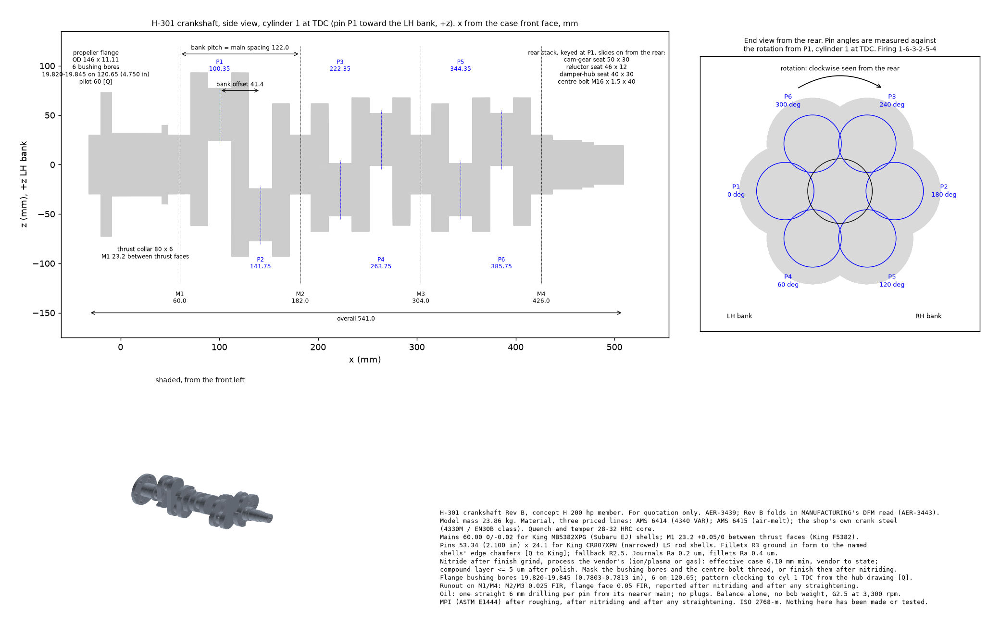

# Concept H crankshaft: catalog crank or one-off, and the H-301 drawing

Owner: PROPULSION. Issue: AER-3439 (raised by MANUFACTURING, AER-3384; costs from AER-3412; DFM read AER-3443). Date: 2026-10-18.
Status: **a recommendation and a Rev B quoting drawing (Rev B folds in MANUFACTURING's DFM read, section 7). Nothing here has been made, measured or run.** This is an experimental engine design. Nothing in it is certified, certifiable or flight-ready. Bill declares any freeze.

Numbers come from [`analysis/engine_crank/crank_decision.py`](../../analysis/engine_crank/crank_decision.py) (tables in `crank_decision_tables.md`) and the crank model from [`cad/concept_h/h_crank.py`](../../cad/concept_h/h_crank.py). Both read one parameter file, [`cad/concept_h/h301_params.json`](../../cad/concept_h/h301_params.json). Tags: **[S]** sourced (URL and read date in [`sources/CRANK_SOURCES_2026-10-18.md`](sources/CRANK_SOURCES_2026-10-18.md), addendum), **[E]** PROPULSION estimate with its method in the script, **[A]** assumed, **[Q]** needs a quote or a vendor drawing. **None of these figures is a quote.**

*H-301 Rev B. Side view with cylinder 1 at TDC; end view from the rear with each pin's angle; shaded view; the notes block carries material, journals, fillets, nitriding, runout, oil, balance and inspection.*

## 1. The answer

1. **The adapted catalog billet does not fit concept H, and no adaptation can make it fit.** A 2JZ or RB26 billet is an inline-6 crank. Its throws come in mirror pairs (0 / 120 / 240 / 240 / 120 / 0 degrees), so it has three pin angles. H's opposed six needs six. On H's alternating banks, the inline-6 throws put the six TDCs 60 degrees apart, and **no even firing order exists**. Every one of the 20 three-and-three bank assignments was enumerated and none fires evenly (section 2). The catalog strokes are also wrong: 86, 94 or 96 mm [S] against 101.6. Pin spacing is one per bore, there are 7 mains, and the front end is a flywheel flange. Re-indexing a finished crank's pins is not a machining operation. Using that crank means building a different engine, an inline-6, not adapting H.
2. **A third candidate came out of AER-3412 and it does fit: the Continental O-470 / IO-520 crank.** It is an opposed six with 4 mains and H's exact 4.000 in stroke. It has an integral propeller flange and 4th-, 5th- and 6th-order pendulum dampers [S, Continental IO-520 overhaul manual]. **Ready to install, it is not cheaper:** $8.2k-10.5k on loaded listings [S, AER-3443], and $11,924 new [S]. **As a core plus a crank-shop overhaul it could be:** $1.5k-3k [E, AER-3443: a $95-900 core, $1,309 overhaul, $257 ultrasonic, $375 balance], but only if the core passes inspection. It must be VAR (AD 97-26-17), and the 1998-2000 forgings carry further ADs [S, AER-3443]. Against that saving of roughly $4k-7k, it forces H's case onto Continental's main spacing (not found), and its 2.250 in pins rule out the catalog LS rods. **Measuring a $95 as-is core [S] is the cheap way to find out whether that redraw is worth it.** Until then it is the torsional reference and an open cost lever, not the pick.
3. **Recommendation: a one-off billet to drawing H-301, from a crank specialist.** **$6.6k-9.4k including balance [E, envelope 9.4], about 18-20 weeks [S, reseller figure].** Quote route 5 (general turn-mill shop, $7k-19k, 6-12 weeks [E, AER-3412]) to the same drawing as the lead-time alternate. If Bill takes the geared EZ36 variant on AER-3411, its $524 OE crank replaces this one, and H-301 becomes the fallback.
4. **Two changes to concept H come with the drawing, both found by drawing the crank.**
   - **Bank pitch 111.8 to 122.0 mm** (section 3). At 111.8 mm, two separate pins per bay leave 13.9 mm webs. On the same split-at-the-mains method, that is 1.7x the web bending stress of a cast LS crank, which leaves only the same fatigue margin as that crank (ratio 1.02). At 122 mm the webs are 17.3 mm and the margin is 1.45x the LS crank's. The case and crank grow by 31 mm.
   - **The LS7 rod-and-liner stack does not clear a staggered opposed crank** (section 6). At BDC the opposed rod's big end and the middle web reach into the other bank's piston. The overlap is 8-9 mm on a relieved-skirt model and up to 20 mm on a full-skirt one. The web ends and big ends also sweep 5-6 mm through the bottom of the Darton liner. **Neither is a crank feature.** The fix is a longer catalog rod and a higher deck. 6.360 in turned out not to be a catalog length; 6.460 in is, from three makers [S, AER-3443], and 6.560 in exists [S, AER-3442]. The rod, piston and deck pick belongs to AER-3442. The counterweights are not the problem: at R62 they clear by 11 mm even on the full-skirt model.
5. **Torsion: fit a viscous damper on the rear snout.** With the geometry drawn, mode 1 is **255 Hz**. Its 6th-order crossing is at **2,549 rpm, in the cruise band** (FL-24 stands). Undamped, the worst nominal vibratory shear in the journal is **33 MPa**, against a 34 MPa yardstick (IACS M68 form, with an oil-hole factor [E]). It is **66 MPa if the crank's damping is half the assumed value**. A viscous damper on the free (rear) end, at a catalog Fluidampr's ring inertia of about 0.015 kg m^2 [E, AER-3443], holds the worst case to **7.6 MPa, and 8.4 MPa** across every sensitivity case (0.010 kg m^2 gives 10.5). Its damping coefficient is not published [Q to Fluidampr]. Pendulums at the rear give 13 MPa. Pendulums at the propeller end do nothing, because that end is a node (section 4).

## 2. Deciding physics 1: what the crank can fire

`crank_decision.py` section 1. A cylinder reaches TDC when its pin points at its own bank. Even firing for a four-stroke six needs the TDCs, taken mod 360, to fall in three pairs 120 degrees apart. Each pair fires 360 degrees apart.

| Crank on H's L R L R L R banks | TDC mod 360, cylinders 1-6 | Even 120-degree orders |
|---|---|---|
| H-301 boxer throws: pairs 180 apart, bays at 0 / 240 / 120 | 0, 0, 240, 240, 120, 120 | 8. **1-6-3-2-5-4** chosen: it alternates banks, so each bank fires every 240 degrees |
| Inline-6 catalog throws (2JZ, RB26) | 0, 300, 240, 60, 120, 180 | **none** |
| Inline-6 throws, any 3 + 3 bank assignment | | **none of 20** |

The H-301 throws leave no free primary or secondary force or couple (machine zero, section 1 of the tables), as expected for an opposed six. **So the crank balances alone, with no bob weight**, provided rods are matched end for end and pistons by weight across each opposed pair.

## 3. Deciding physics 2: the webs at H's pitch

`crank_decision.py` section 3. Method: each bay is simply supported at its two mains, one rod fires at a design load of 70 bar [A] (60.4 kN), and the nominal bending stress is taken at the web next to the nearer main. The method over-predicts absolute stress, so it is used as a **ratio to a crank that runs**: a cast-iron GM LS crank at 80 bar [A] (155 MPa on the same method). Nitrided 4340 has 1.75x pearlitic ductile iron's fatigue strength (CRANK_AND_SCALING 3.3).

| Bank pitch (mm) | Webs (mm) | Longer by (mm) | Web stress (MPa) | Margin vs a cast LS crank |
|---|---|---|---|---|
| 111.8 (as drawn in H-101/102) | 13.9 | 0 | 266 | 1.02 |
| 118.0 | 15.9 | 19 | 212 | 1.28 |
| **122.0 (H-301)** | **17.3** | **31** | **187** | **1.45** |
| 128.0 | 19.3 | 49 | 158 | 1.72 |

At 111.8 mm H's crank would carry, continuously, the margin a car crank has only at full throttle. 122 mm is my pick: it buys 45 % more margin than the LS reference for 31 mm of length, about 2-3 kg of case and crank [E]. It also opens the gap between liners from 7.0 mm to about 17 mm, which helps the coolant jacket. The cycle model puts H's peak pressure at 51 bar, against the 70 bar design load, so the absolute margin is larger than the table shows. The table is not a stress analysis. FEA of a throw is open (section 8).

## 4. Deciding physics 3: torsion, H-301 at 122 mm

`crank_decision.py` section 4. A 9-mass chain: propeller, nose, six throws, and the rear (cam gear and accessory drive). **Stiffness comes from Carter's equivalent length** (Ker Wilson) on the drawn journals, pins and webs, split into a term per feature. Phase 1 assumed its stiffnesses. **Excitation** is the gas plus reciprocating inertia torque of one cylinder from a single-zone Wiebe cycle scaled to H's IMEP (12.1 bar, peak 51 bar, indicated torque 507 N m against 508 needed). It is phased by firing order and swept at full throttle along the fixed-pitch propeller curve. **Damping:** crank loss factor 0.04 [A], plus the propeller's aerodynamic damping.

- **Modes 255 / 705 / 1,147 Hz.** Phase 1's assumed chain gave 261 / 768 / 1,274, so the drawn geometry confirms it. The mode-1 shape runs -0.05 at the propeller to 1.00 at the rear: **the propeller is a near-node and the rear end swings most.**
- **Mode-1 crossings between 1,000 rpm and 120 % of rated:** order 6 (major) at **2,549 rpm**, order 9 (major) at 1,700, order 7.5 at 2,040, and order 4.5 at 3,399.

| Option | Worst nominal shear, 1,000-3,465 rpm | At |
|---|---|---|
| no damper | **33.2 MPa** | 2,550 rpm (6th order) |
| **viscous damper on the rear snout** (ring 0.015 kg m^2 [E], catalog class, damping tuned by sweep to 20 N m s/rad) | **7.6 MPa** | 3,300 rpm, off-resonance |
| two 6th-order pendulums on bay 3 (rear) | 13.2 MPa | 1,325 rpm |
| two 6th-order pendulums on bay 1 (propeller end) | 32.0 MPa | 2,275 rpm |

| Sensitivity | Mode 1 | No damper | Viscous damper |
|---|---|---|---|
| baseline | 255 Hz | 33.2 MPa | 7.6 MPa |
| crank stiffness x0.8 / x1.2 | 233 / 274 Hz | 28.1 / 37.7 | 8.4 / 8.4 |
| loss factor 0.02 | 255 Hz | **65.7** | 7.9 |
| propeller 0.6 / 2.5 kg m^2 | 260 / 250 Hz | 32.0 / 34.3 | 7.3 / 8.0 |
| ring 0.010 / 0.020 / 0.035 kg m^2, worst of the cases above | | | 10.5 / 8.2 / 7.7 |

**The TV case for H-301, stated:** without a damper the 6th-order resonance sits in cruise, at the yardstick, and doubles if damping is lower than assumed. That is FL-24 with geometry behind it. **A rear viscous damper of catalog size takes the worst case to about a quarter of the yardstick and makes it insensitive to every uncertainty swept.** It treats all orders and modes at once. It is one bought part (Fluidampr, $483-528 [S, AER-3443]) on a hub turned from files, instead of pendulums, pins and bushings machined into the crank. The rear is where the mode swings, and where H has room. The yardstick is a shaft rule used as a guide, not a crank rule, and the stresses are nominal: fillet and oil-hole concentrations sit on top of them.

**Why not Continental's pendulums?** They work. The model's 6th-order pendulum needs an effective length of 2.0 mm, and Continental's 6th-order pin in its bushing bore gives 1.7-1.8 mm [S], a match that suggests the model is sound. But a pendulum treats one order. At the rear it holds 13 MPa, not 7. It also adds machined blades, bushings, pins and an inspection item (FL-25). The drawing reserves no pendulum blades, so choosing them later would mean a Rev B.

**What would prove it:** a dynamometer torsional survey (angular velocity at the free end, order-tracked), run with and without the damper, before flight. It is the only test that turns these numbers into evidence.

## 5. The H-301 specification, against the 10 rfq-package-v1 items

The Rev B print is `cad/concept_h/H-301_drawing.png`. The solid is `cad/concept_h/H-301.step` (one valid solid, model mass **23.9 kg**, 541 mm overall; Rev A was 24.6 kg, and CRANK_AND_SCALING's independent estimate was about 24 kg). Engine frame: x from the case front face toward the rear, +z the LH bank, cylinder 1 at TDC.

| # | rfq item | H-301 Rev B | Basis |
|---|---|---|---|
| 1 | Throw layout and phasing | 6 throws, 3 bays, LH rod forward in each bay. Pins at 0 / 180 / 240 / 60 / 120 / 300 degrees against rotation from P1 (P1-P6). Rotation clockwise seen from the rear. Firing **1-6-3-2-5-4**. **Bank offset 41.4 mm** (was 38.6) | section 2 |
| 2 | Main journals | **4 x 60.00 mm, 0 / -0.02** for **King MB5382XPG** (Subaru EJ) shells, 15.1 mm wide; two sets per engine, $190-200 [S, AER-3443]. Width 22; **M1 23.2 +0.05/0** between thrust faces. **Spacing 122.0** (M1-M4 at x 60, 182, 304, 426) | the 60 mm shell is real: King's table, 59.98-60.00 journal, 64.00 housing [S, AER-3443] |
| 3 | Rod journal | **53.34 mm (2.100 in) x 24.1 mm wide**, one LS rod per pin, for **King CR807XPN** narrowed shells (20.1 mm; $98-108 per 8 [S, AER-3443]). Fillets ground to that shell's edge chamfer. Rod length set by AER-3442 (6.460 or 6.560 in, both catalog). Pin 0.927 in [S] | the standard CR807SI (21.3 mm) would ride an R3 fillet by 0.46 mm; the XPN by 0.17 mm, which King must confirm [Q]. Fallback R2.5 |
| 4 | Counterweights against the liner skirt | Counterweights on the six outer webs, **R62 over +/-55 degrees**. **Envelope R70** (3 mm on a full-skirt model), R80 on a relieved one. The interference found is rod, web and piston against the stack, not counterweight (section 6) | swept clearance, Darton sleeve 147.3 mm [S] |
| 5 | Thrust | M1, between the rear face of an **80 x 6 mm thrust collar** [E; at least the King F5382 flange OD, Q] and web A; King F5382 flanged shell, 23.0 mm overall [S]; end float 0.10-0.25 mm [E]. Rev A had only a 2 mm shoulder in front (DFM B2). Load: tractor thrust about 2.3 kN static [E, DRIVE_AND_PROP] | |
| 6 | Propeller flange | **Lycoming Type 2 pattern: 6 bushings on 4.750 in (120.65 mm)** [S, SI 1098Q]. Bores **19.820-19.845 mm** (0.7803-0.7813 in) for **72060-S bushings** (OD 0.7818-0.7823 in, 0.0005-0.0020 in tight [S]). Flange 0.44 in (11.11 mm) thick [S, the O-540 class]. OD 146 [E]. Pilot 60 x 12, and the **clocking of the pattern to cylinder 1 TDC**, both **[Q, from the propeller vendor's hub drawing]**. Mask the bores during nitriding, or finish them after it. Face runout 0.05 mm FIR [E] (Continental's service limit is 0.005 in [S]). Solid nose: no oil to the propeller (option 3b is ground-adjustable; an electric pitch hub needs none) | |
| 7 | Rear snout | **Rev B: an automotive-style stack that steps down toward the rear**, so every ring slides on from the rear: cam-gear seat 50 x 30, reluctor seat 46 x 12 (one wheel, both FADEC lanes' sensors), damper-hub seat 40 x 30. Each is keyed (8 x 4 mm) at P1's angle, which clocks the cam and the trigger to cylinder 1. **One M16 x 1.5 centre bolt** (40 deep) clamps hub, reluctor and cam gear against the M4 shoulder; no shrink fit, and the cam gear comes off at overhaul. Rev A's integral 110 mm flange trapped the 50 and 46 mm rings (DFM B1) | the hub is a separate turned part, drilled to Fluidampr's 6 x 5/16-24 on 3.2 in pattern [S-snip, AER-3443]; not drawn this pass |
| 8 | Oil drilling | One straight 6 mm drilling per pin from its nearer main: P1/P3/P5 from the bay's front main, P2/P4/P6 from its rear main. Enters the main 90 degrees behind the pin, exits the pin 60 degrees ahead of its outermost point [E]. Ends broken and polished, **no plugs**. Exit angle checked against the bearing load polar at Rev B | |
| 9 | Fillets, treatment, material, balance | **R3 fillets** on every journal, ground in form, no undercut; journals Ra 0.2 um, fillets Ra 0.4 um. **Three priced material lines: AMS 6414 (4340 VAR), AMS 6415 (air-melt), and the shop's own crank steel** (4330M / EN30B class, what Bryant and Callies stock [S, AER-3443]); quench and temper to 28-32 HRC core. The VAR premium is [Q]; on an 8 in bar of about 314 lb, air-melt is $410-1,160 [S, AER-3443]. **Nitride after finish grind as a requirement, not a process:** effective case 0.10 mm minimum, vendor to state; compound layer 5 um or less after polish; ion/plasma or gas, the vendor's choice. Rev A's 0.30-0.50 mm gas nitride was deeper than Bryant's published 0.10 mm and excluded its process, and was the likely price driver. MPI (ASTM E1444) after roughing, after nitriding and after any straightening; runout reported after the last straightening. **Balance the crank alone, no bob weight**, ISO 21940-11 G2.5 at 3,300 rpm [E] | sections 2, 4; envelope 9.4 |
| 10 | Torsional check and damper | Done (section 4). **Viscous damper on the rear hub**; the propeller end needs no damper snout. Damper: a catalog Fluidampr (FDR571101 $483, 720101 $517-528 [S, AER-3443]), ring about 0.015 kg m^2 [E]; the model holds 8.4 MPa worst case at that size. Its damping coefficient is [Q to Fluidampr]. A custom unit (Vibratech, Geislinger) only if Fluidampr's coefficient is far from 20 N m s/rad | section 4 |

**What a crank shop still needs that is not on this sheet:** a dimensioned 2-D release print. Rev B is a quoting print, as Bryant's form and MANUFACTURING's checklist ask. It is not a production drawing. Shops quote custom cranks from "prints and/or specifications" [S, rfq-package-v1], and this sheet plus the STEP is that specification.

## 6. Finding: the LS7 stack against a staggered opposed crank

`crank_decision.py` section 6 sweeps the crank, both rods' big ends (42 mm radius about the pin [A]), the webs and the counterweights through 720 degrees. It checks them against every piston and liner bottom. The liner bottom is 87.7 mm from the axis: the deck at 235 mm, less Darton's 147.3 mm sleeve. Two piston models are used, because no catalog piston drawing is in hand. The **disc** model is the full bore down to 30 mm below the gudgeon pin [A]. The **relieved** model has skirt panels on the thrust sides only, and pin bosses [A].

| Feature | Against | Disc (mm) | Relieved (mm) |
|---|---|---|---|
| middle web | other bank's piston at BDC | -20.0 | -9.0 |
| opposed rod big end | other bank's piston at BDC | -19.5 | -8.6 |
| web ends | liner bottom | -5.6 | -5.6 |
| opposed rod big end | liner bottom | -5.1 | -5.1 |
| counterweights (R62) | piston | +11.3 | +23.3 |

**Why it happens:** in each bay the two pins are 180 degrees apart, so when one cylinder is at BDC its opposed partner's pin, middle web and big end swing toward it. The bank offset (41.4 mm) is inside the bore radius (52.4 mm), and the LS7's 6.067 in rod puts the BDC gudgeon pin only 103 mm from the axis. Continental's pistons carry "cylindrical relief cuts at the bottom to clear the crankshaft counterweights" [S, IO-520 manual], so the problem is a known one in this layout.

| Rod (in) | Deck rise (mm) | Piston gap, relieved (mm) | Liner gap (mm) | Catalog, 2.100 in journal |
|---|---|---|---|---|
| 6.067 | 0 | -8.4 | -5.6 | LS7 |
| 6.200 | 3.4 | -5.0 | -2.2 | Eagle ESP [S] |
| 6.360 | 7.4 | -0.9 | +1.8 | **not a catalog length** (the snippet did not confirm, AER-3443) |
| **6.460** | **10.0** | **+1.6** | **+4.4** | **Summit SUM-LS6460927 $750 / 8; Eagle CRS6460O3D20-1 $137 each; Callies U16301 $1,952 / 8 [S, AER-3443]** |

**Owned by AER-3442.** MANUFACTURING recommends the 6.460 in rod (clears with no relief cuts on this model). AER-3442's finer sweep of the pin-boss region is weighing 6.460 against 6.560 in (deck +11 mm). A longer rod also lowers the side thrust. The cost is case height and a piston chosen for the new deck. **This changes H-101, H-102 and the cylinder module, not the crank**, so it goes to a castings revision (section 8), not to H-301.

## 7. Rev B: what MANUFACTURING's DFM read changed (AER-3443)

| DFM item | Rev A | Rev B |
|---|---|---|
| B1, rear assembly | 50 and 46 mm rings trapped between the 60 mm M4 and an integral 110 mm flange | stepped, keyed snout, centre bolt, separate damper hub |
| B2, thrust | 2 mm shoulder ahead of a 26 mm M1 | 80 x 6 collar, M1 23.2 for King F5382 |
| B3, pin fillets | unnamed rod shell | King CR807XPN named; R2.5 fallback [Q] |
| Nitride | gas, 0.30-0.50 mm | requirement only, 0.10 mm minimum, process the vendor's |
| Mains | -0.013 / -0.025 | 0 / -0.02 to King MB5382 |
| Bushing bores | 19.82 | 19.820-19.845, clocking [Q], masked or finished after nitride |
| Material | VAR, air-melt alternate | three priced lines, incl. the shop's own steel |

**Not taken:** trimming the pin-end web radius from 42.5 to 37 mm (a 7.5 in bar and 5.5 mm more liner clearance). The longer rod in AER-3442 clears the liner without it, and the web is the stressed part.

## 8. Failure ledger

Added **FL-50** (Rev A) and **FL-70 to FL-72** (Rev B, from MANUFACTURING's build-quality list). FL-50: the rear viscous damper loses its fluid or degrades. FL-24's 6th-order resonance then returns at about 2,550 rpm, 33-66 MPa nominal, with no cockpit cue. Mitigation: a damper inspection and replacement interval, and a dynamometer survey with and without the damper so the undamped margin is known. Section 6 is a design finding, not a service failure. An engine assembled without the fix would lock on its first hand rotation.

## 9. What this pass did not do, and what is open

- **No quotes.** MANUFACTURING's `rfq-package-v2` (on AER-3443) is drafted against Rev A; it needs re-pinning to the Rev B commit. Sending it waits on AER-3330/AER-3333 (Bill: who sends RFQs).
- **The castings now match the AER-3442 geometry.** H-101/H-102/H-201 were at the 111.8 mm pitch and 235 mm deck; AER-3442 regenerated them at a 122 mm pitch and 246 mm deck with a 6.560 in rod (CASTINGS_H.md section 9, `analysis/engine_crank/stack_h.py`). RFQ drafts pinned to the earlier STEP files are superseded and need re-pinning to the updated geometry.
- **The 1.75x nitrided-4340 fatigue factor in section 3 (550 MPa) was assumed, not tied to a case depth.** With Rev B's 0.10 mm minimum case it stays [A]; the web-margin ranking across pitches does not depend on it, but the absolute margin does.
- **No FEA, no main-bearing load polar, no oil-film check.** The web check is a comparative sanity check. The 22 mm main width and the oil-hole exits are [E] until the bearing load polar is run.
- **Assumed and not found:** the rod's big-end envelope and piston skirt profile (AER-3442); the propeller pilot and bushing clocking; the Fluidampr ring inertia and damping coefficient; King's CR807XPN chamfer and F5382 flange OD; Continental's main spacing.
- **The Continental core-plus-overhaul route ($1.5k-3k [E]) is an open lever of about $4k-7k.** A $95 as-is core [S, AER-3443] would give its main spacing and pendulum geometry, and so the cost of redrawing H around it. Buying one is Bill's call.
